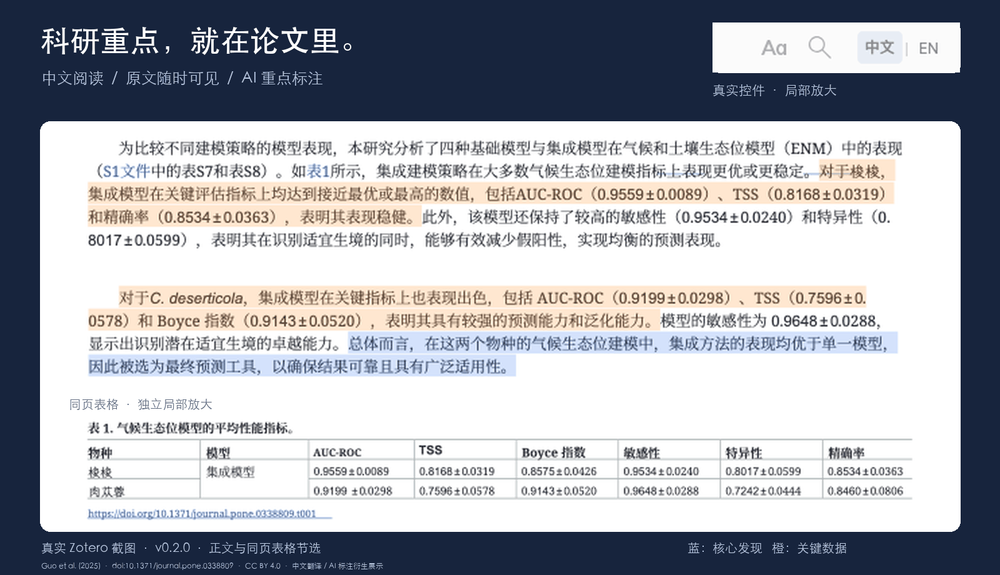
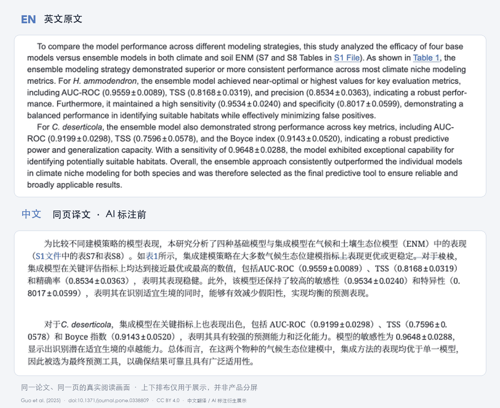
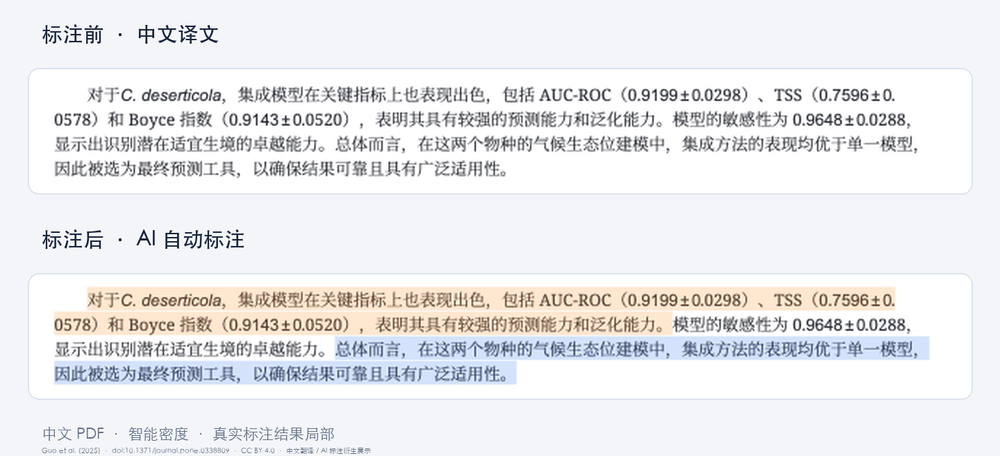

<h1 align="center"> TransYH</h1>

<strong>让科研阅读回归阅读本身。</strong>

英文论文一键翻译 · 中英文无缝切换 · AI 智能标注重点

Full-paper Chinese translation, language switching and AI highlights — for Zotero. Open Source &nbsp; / &nbsp; Zotero &nbsp; / &nbsp; Bring Your Own API

在 Zotero 中完整翻译英文科研 PDF，尽可能保留论文版式；原文随时可见，重点直接标在中文译文里。

  <a href="dist/TransYH-0.2.3.xpi?raw=true">Download</a> ·
  <a href="#quick-start">Quick Start</a> ·
  <a href="docs/demo/README.md">Demo</a> ·
  <a href="docs/USAGE.md">Documentation</a>

当前开发版 v0.2.3 · 已验证 macOS Apple Silicon / Zotero 10.0.6

真实界面截取自 v0.2.0 三页演示：Guo et al. (2025), PLOS ONE；仅原第 7、9、13 页，不代表整篇准确率验证。表中数值属于原论文的生态位模型。<a href="docs/demo/README.md">来源、CC BY 4.0 许可与核对记录 →</a>

## 01 — Read in Chinese

完整翻译英文科研论文，尽可能保留公式、图片、表格和论文版式，英文原件始终保留。

## 02 — Switch Naturally

在同一 Zotero 阅读标签中切换 **中文 / EN**，尽量保留页码、阅读位置和缩放。

## 03 — Focus on What Matters

AI 直接在中文 PDF 中标记**核心发现、关键数据和有依据的方法创新**；支持**精简、智能（默认）、充分**三档密度。

**蓝色：核心发现 · 橙色：关键数据 · 紫色：方法创新。** 本次真实演示接受了 4 处数据、1 处发现，没有紫色创新标记；未为展示补画高亮。已有译文可直接补标，自动标注默认关闭。

**v0.2.3 阅读体验：** 阅读器内查看阶段、进度与耗时，随时取消；中文阅读器顶部可直接“标注重点”。翻译与重点识别支持 **1–10 并发**，默认 4，实际速度取决于模型和服务商限流。[查看版本记录 →](CHANGELOG.md)

## Quick Start

**必须安装两部分：Zotero 插件 XPI + 本地 BabelDOC 引擎。仅安装 XPI 不能翻译。** 另需你自己的 OpenAI-compatible API。

1. **安装插件。** 下载 [TransYH-0.2.3.xpi](dist/TransYH-0.2.3.xpi?raw=true)，在 Zotero → **工具 → 插件 → 齿轮 → 从文件安装插件** 中选择它。更新也使用此入口；当前不提供自动更新或正式 GitHub Release。
2. **安装本地引擎。** 下载并解压 [v0.2.3 完整源码包](dist/TransYH-0.2.3-source.zip?raw=true)。macOS 先安装 [uv](https://docs.astral.sh/uv/getting-started/installation/)（如 `brew install uv`），再双击包内的 `install-engine.command`。脚本安装独立 Python 3.12 与 BabelDOC 0.6.4；首次还需下载模型与字体，请预留网络、至少约 1 GB 空间及额外 PDF 处理空间。[其他系统与安装细节 →](docs/USAGE.md#安装)
3. **配置并阅读。** Zotero → **设置 → TransYH**，检测本地引擎，填写 **API Base URL、API Key、Model**，保存并测试连接。选中英文 PDF，右键 → **翻译全文 · TransYH**；完成后用顶部 **中文 / EN** 切换，按需点击 **标注重点**。

## API 与费用

- **使用自己的 API。** 不预设供应商、模型或 Key，无需另购商业 PDF 翻译或 AI 阅读服务；模型服务商可能按调用收费，测试连接也会产生一次小请求。
- **本地排版，按需发送文字。** BabelDOC 在本机解析和排版；翻译与重点识别会把相关论文文字发送给你配置的模型服务。
- **凭据与缓存。** Key 保存在 Zotero 加密凭据库。已完成的翻译和重点候选尽可能复用；切换标注密度可复用完整候选池。未完成请求不保证复用。

[API 配置、数据处理与缓存说明 →](docs/USAGE.md#api-配置)

## 兼容性与限制

- **已验证：** Zotero **10.0.6 / macOS Apple Silicon**。manifest 支持 Zotero 9–10；9.x、Windows、Linux、Intel macOS 尚未完成独立客户端验证。
- **适用范围：** 原生 PDF 阅读模式；不支持 OCR、扫描件、加密或损坏 PDF、重排文本、EPUB、外部阅读器及独立阅读窗口。中文辅助视图只读，原文与译文批注不互相复制。
- **需要核对：** 图片内文字通常保留原图，复杂表格、特殊字体和密集公式可能存在排版问题。AI 标注不证明研究结论、因果关系或跨文献新颖性；重要数值与结论请回看英文。

[完整兼容性、安装排错、技术架构与开发说明 →](docs/USAGE.md)

## 文档、许可与致谢

[使用说明](docs/USAGE.md) · [真实论文演示](docs/demo/README.md) · [版本记录](CHANGELOG.md) · [历史验证与发布审查](docs/RELEASE_REVIEW_V020.md) · [品牌素材与复用](docs/brand/README.md)

TransYH 以 [AGPL-3.0-or-later](LICENSE) 开源。感谢 [BabelDOC](https://github.com/funstory-ai/BabelDOC)、[Zotero](https://www.zotero.org/) 和 [PyMuPDF](https://pymupdf.readthedocs.io/)；依赖许可见[第三方声明](THIRD_PARTY_NOTICES.md)。

演示论文：Guo J-X, Wu Y, Zhang T-D, Lv F-L, Gong Y-F (2025). *Dual niche modeling with GEE and SHAP for predicting habitat shifts of Haloxylon ammodendron and Cistanche deserticola under climate change*. **PLOS ONE 20(12): e0338809**. [DOI: 10.1371/journal.pone.0338809](https://doi.org/10.1371/journal.pone.0338809).

原文与图表 © 2025 Guo et al., [CC BY 4.0](https://creativecommons.org/licenses/by/4.0/)。中文翻译、AI 标记、截图裁切与组合为 TransYH 衍生展示，不代表原作者、PLOS 或 Zotero 认可；论文内容不改用项目的 AGPL 许可。[完整来源与改动声明 →](docs/demo/README.md)
