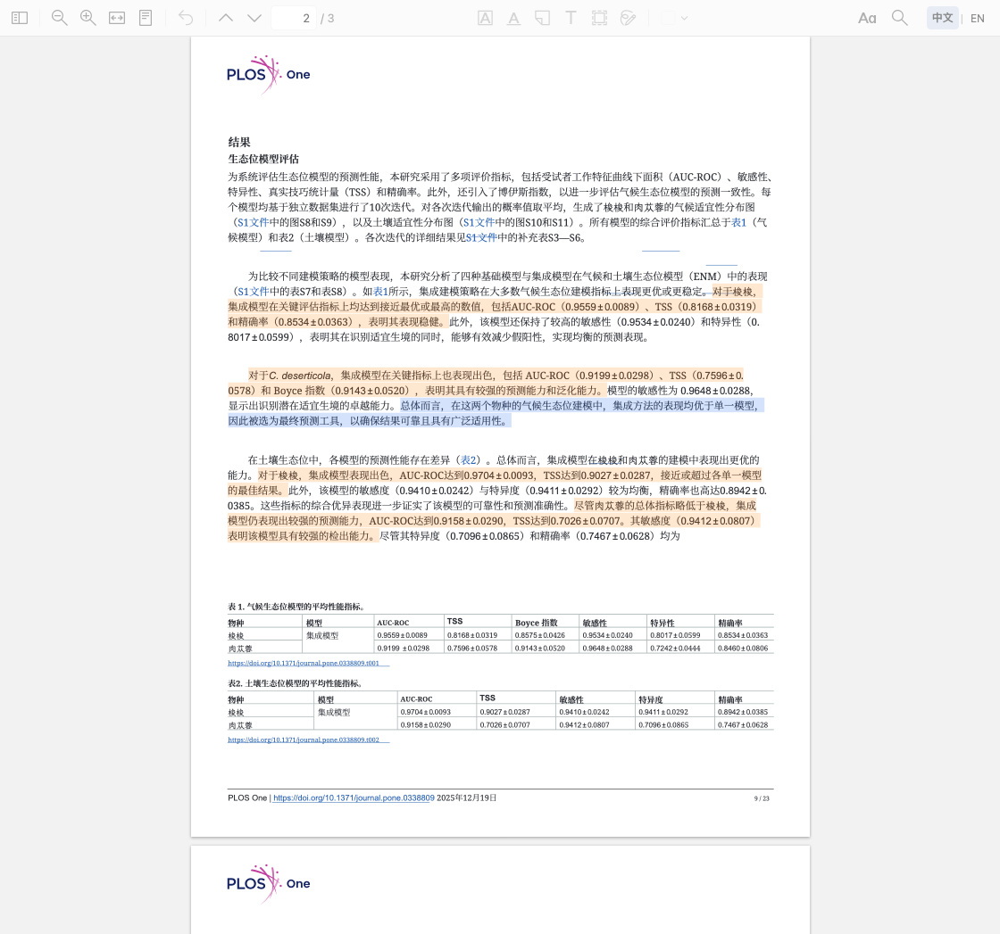
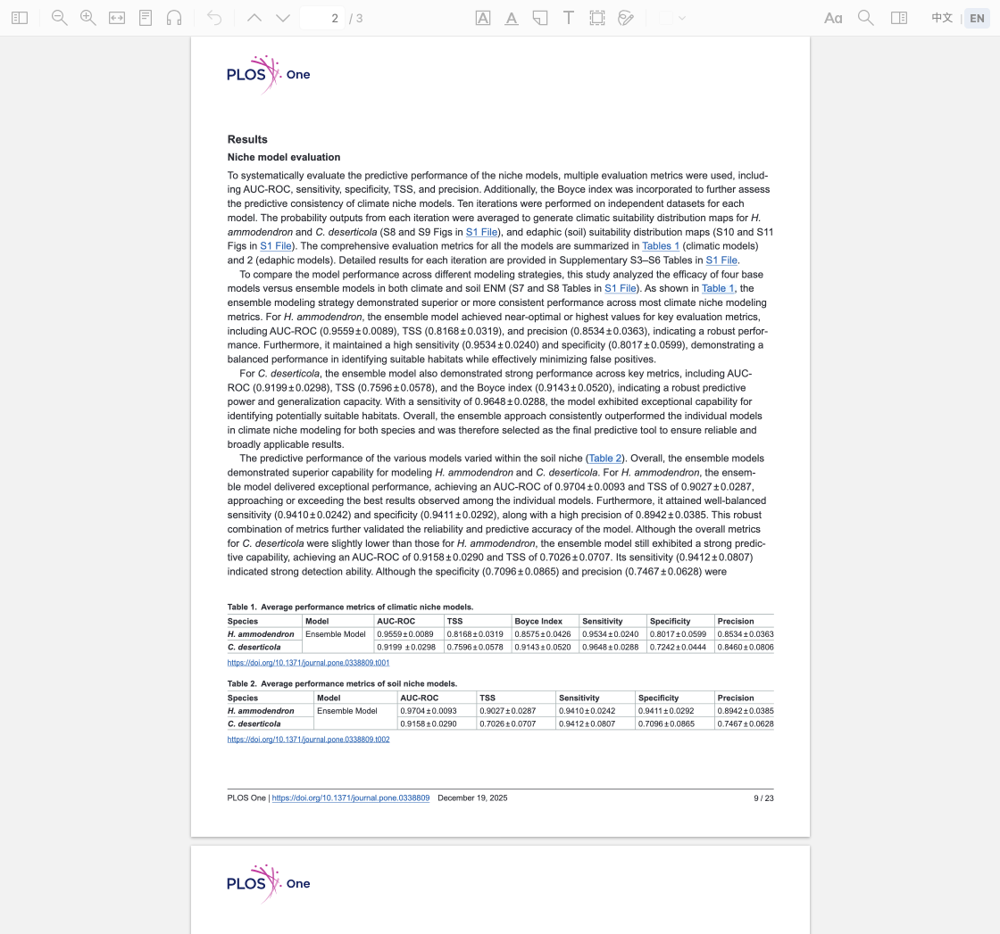
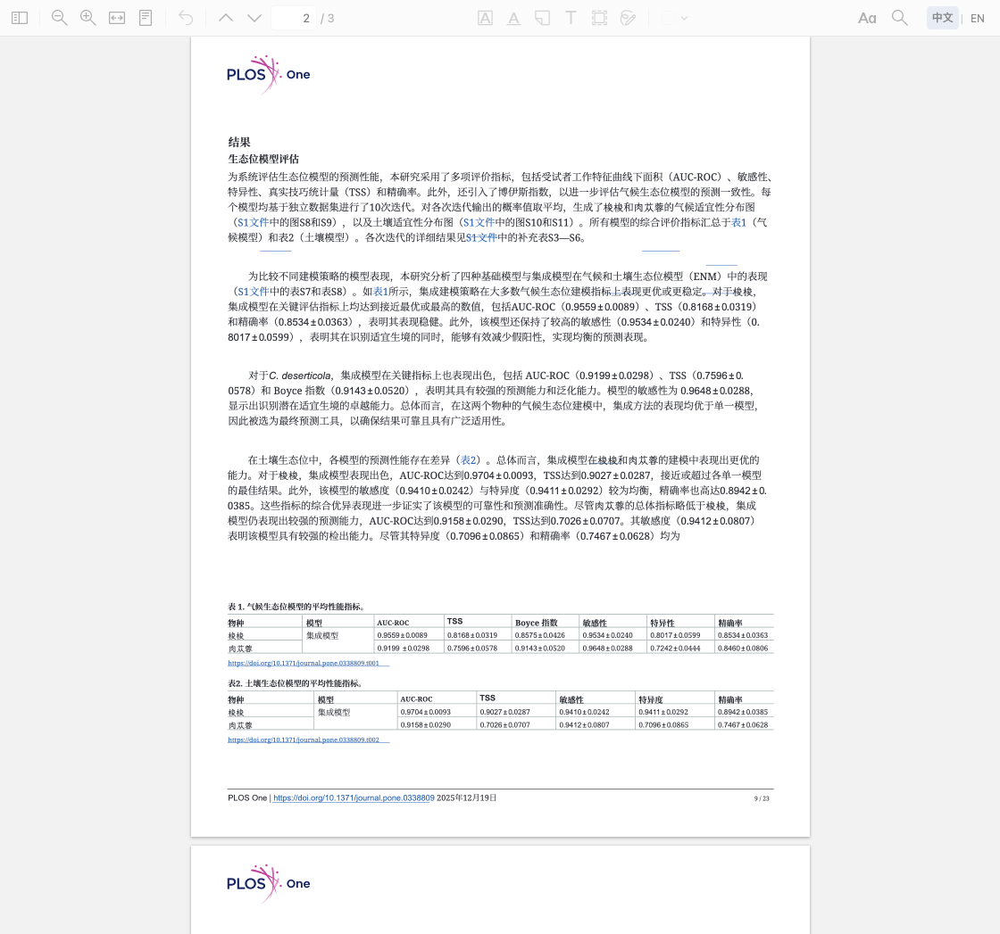

# TransYH

**让 Zotero 中的英文科研论文变成可以一键切换原文、完整中文翻译和 AI 重点标注的阅读体验。**

Translate research PDFs into Chinese, switch languages in one Zotero tab, and highlight evidence-backed findings with your own OpenAI-compatible API.

当前开发版 **0.2.3** · 已验证 **macOS Apple Silicon / Zotero 10.0.6**。本仓库提供开发分支中的安装文件，尚未创建正式 GitHub Release。

## 看看实际效果



真实论文演示：Guo et al. (2025), *PLOS ONE*, [DOI: 10.1371/journal.pone.0338809](https://doi.org/10.1371/journal.pone.0338809)，原文第 9 页。只翻译原文第 7、9、13 页的小规模节选；不代表整篇翻译验收。原文与图表 © 2025 Guo et al., [CC BY 4.0](https://creativecommons.org/licenses/by/4.0/)。中文翻译和 AI 标记为 TransYH 衍生展示，不代表作者认可。模型、截图来源及逐项核对见[演示记录](docs/demo/README.md)。

<details>
<summary>展开查看同一页的英文、中文和标注前对照</summary>

英文原文：



中文译文，标注前：



[标注前截图](docs/demo/highlights-before.png) · [标注后截图](docs/demo/highlights-after.png)

</details>

- **中文原文直接阅读**：本地抽样识别中文为主的正文，点击“中文”直接阅读原件；工具栏持续显示任务阶段、百分比和耗时，并可直接取消。
- **全文英译中**：本地 BabelDOC 解析和排版，尽可能保留公式、图表与页面结构；英文原件保留。
- **同标签中文 / EN 切换**：复用原生阅读器，保存页码、缩放和阅读位置。
- **PDF 内 AI 重点**：阅读器顶部可直接补标；蓝色核心发现，橙色关键数据，紫色有明确依据的方法创新；已有译文也能直接标注。
- **最多 10 并发**：翻译和重点识别均按设置并行请求，默认 4；设置中可提高到 10，已完成段落和候选批次缓存继续复用。
- **三档密度**：精简、智能（默认）、充分，按学术重要性筛选，没有固定的每页条数上限。
- **使用自己的 API**：支持 OpenAI-compatible 服务；自动标注默认关闭，重复标注与切换密度尽可能复用候选缓存。

## 安装与开始使用

**需要安装两部分：Zotero 插件 XPI + 本地 Python/BabelDOC 引擎。仅安装 XPI 还不能翻译。**

1. 下载 [TransYH-0.2.3.xpi](dist/TransYH-0.2.3.xpi?raw=true) 和[完整源码包](dist/TransYH-0.2.3-source.zip?raw=true)。源码包包含本地引擎安装脚本，先解压。
2. Zotero → **工具 → 插件** → 齿轮菜单 → **从文件安装插件**，选择 XPI。更新时也通过此入口安装，让 Zotero 重新加载插件及配套引擎文件；安装后可在插件管理器核对版本 **0.2.3**。
3. macOS 安装 [uv](https://docs.astral.sh/uv/getting-started/installation/)；使用 Homebrew 可运行 `brew install uv`。在解压目录中双击 `install-engine.command`，或在该目录的终端运行：

   ```bash
   chmod +x install-engine.command
   ./install-engine.command
   ```

   脚本安装独立 Python 3.12 环境及 BabelDOC 0.6.4。首次使用还会下载开源版式模型与字体，请准备网络和至少约 1 GB 可用空间，以及处理 PDF 的额外空间。
4. Zotero → **设置 → TransYH**：先点 **检测本地引擎**，再填写 **API Base URL、API Key、Model**，保存并点 **测试连接**。例如 `https://provider.example/v1`；实际地址和模型由你的服务商提供。
5. 选中文献或英文 PDF，右键 → **翻译全文 · TransYH**。完成后生成独立中文附件，并在阅读器中显示中文。
6. 使用顶部 **中文 | EN** 切换。已有中文可点击阅读器顶部 **标注重点**，或右键 → **AI 标注重点**；设置里可开启 **翻译完成后自动标注重点**，并选择标注密度。

Windows 的 `install-engine.ps1` 和 Linux 安装路径已实现，**尚未完成客户端验证**。其他 Python 路径、HTTP 服务授权、重译与故障处理见[详细使用说明](docs/USAGE.md)。更新时手动安装新 XPI，当前没有自动更新服务。

## AI 标注如何使用

| 密度 | 保留的信息 |
| --- | --- |
| 精简 | 直接支撑主要贡献的核心发现、决定性数据和关键创新 |
| 智能（默认） | 核心内容，加上具有独立学术价值的重要信息 |
| 充分 | 再纳入有证据支持的补充发现、稳健性、边界条件与次要比较 |

三档共用真实性、精确引用、限定条件、去重及防重叠检查，允许完全不标。保存密度后，对已有译文再次执行 **AI 标注重点** 应用新密度；复用完整候选池，不因切换密度重复调用模型。首次从旧候选协议升级需重新识别一次。

标记直接绘入中文 PDF 的半透明图形层，不添加侧边栏、总结或聊天。更新前备份中文原文件，使用原子替换并保留同一附件 ID 和已有批注；失败或取消时保留原译文。普通翻译复用已有中文；主动 **重新翻译 · TransYH** 才会创建新版译文，旧附件及批注保留。

## API、隐私与费用

- 不需要购买其他商业 PDF 翻译或 AI 阅读服务。本地开源引擎负责 PDF 解析、版式识别和排版。
- 翻译和重点识别会把相关论文文字发送给**你配置的模型服务**，服务商可能按请求收费；测试连接也会发送一次小请求。耗时与费用取决于页数、模型和限流。
- API Key 存入 Zotero 的加密登录凭据库，不进入普通设置、源码、日志或 GitHub。项目不预置个人地址、模型或 Key。
- PDF 质量检查在本地执行，不额外调用 AI。标注候选缓存不保存正文或 Key；全文翻译缓存、PDF 备份和恢复记录留在本机。缓存不能保证复用尚未完成或尚未落盘的请求。

## 兼容性与已知限制

- 已验证 Zotero **10.0.6 / macOS Apple Silicon**。manifest 支持 9–10，但 Zotero 9.x、Windows、Linux 和 Intel macOS 尚未完成独立客户端验证。
- 支持原生 PDF 阅读模式；中文辅助视图只读，原文与译文批注不互相复制。不支持重排文本、EPUB、外部阅读器或独立阅读窗口。
- 没有 OCR；扫描件、加密或损坏 PDF 不适用。图片内部文字通常保留原图，复杂表格、特殊字体、密集公式仍需人工检查。
- 中文检测使用本地文字抽样；文字稀少、提取异常或复杂混排的 PDF 可能无法正确识别。
- AI 标注不证明研究结论真实、因果关系成立或方法具有跨文献新颖性。错误译文也可能影响选择，重要数值和结论应回看英文。
- 同时驻留两份 PDF 会增加内存；大型论文、云同步冲突及极端磁盘故障仍存在未验证边界。

详见[完整使用与技术说明](docs/USAGE.md)、[版本记录](CHANGELOG.md)、[0.2.0 测试记录](V020_TEST_RESULTS.md)和[发布审查材料](docs/RELEASE_REVIEW_V020.md)。

## 开发与测试

需要 Node.js 22+；本地引擎使用 Python 3.12。首次开发安装依赖后构建：

```bash
npm ci
npm run typecheck
npm run build
```

开发阶段只运行改动相关的用例；TypeScript 修改运行 typecheck。合并前按风险统一验证，避免逐次重启客户端、重复翻译和打包：

```bash
npm test
npm run test:engine
npm run test:zotero
npm run package
python3 scripts/audit-release.py
```

引擎测试需要 `.venv`、固定依赖与 pytest；初始化方式见[开发说明](docs/USAGE.md#构建与测试)。Zotero 测试使用独立资料库和本机 Mock，不使用个人论文或真实 Key。Mock 结果只证明软件链路，不代表真实模型准确率。当前轮实际执行结果以发布审查记录为准。

## 许可证与致谢

TransYH 使用 [AGPL-3.0-or-later](LICENSE)。感谢 [BabelDOC](https://github.com/funstory-ai/BabelDOC)、[Zotero](https://www.zotero.org/)、[PyMuPDF](https://pymupdf.readthedocs.io/) 及其他依赖项目，版本与许可证见[第三方声明](THIRD_PARTY_NOTICES.md)。演示论文及其图表保留原作者版权并按 CC BY 4.0 署名，不改为本项目许可证。
