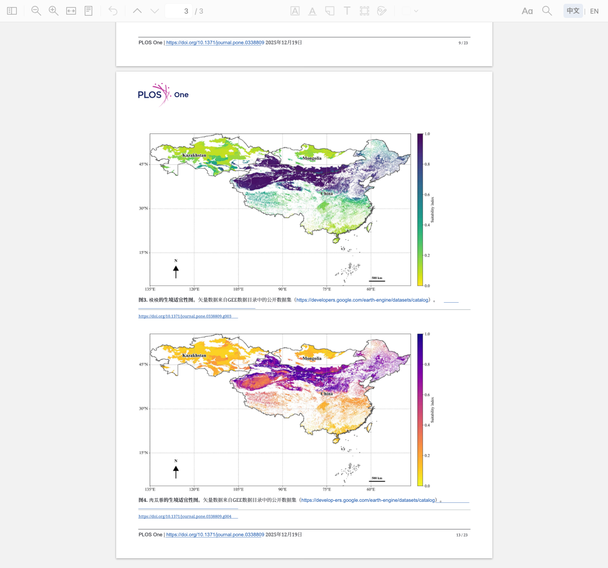

# 真实论文演示：来源、截图与核对

日期：2026-10-29（Asia/Shanghai）。插件 **TransYH 0.2.0**，Zotero **10.0.6**，macOS Apple Silicon。基于 `b227c4bfa327281157d1c1c9d1730c1d4b4f0334` 的实现，本轮不改翻译、缓存或阅读器功能。

## 论文与使用许可

Guo J-X, Wu Y, Zhang T-D, Lv F-L, Gong Y-F (2025). *Dual niche modeling with GEE and SHAP for predicting habitat shifts of Haloxylon ammodendron and Cistanche deserticola under climate change*. PLOS ONE 20(12): e0338809.

- DOI：[10.1371/journal.pone.0338809](https://doi.org/10.1371/journal.pone.0338809)。
- [期刊官方文章](https://journals.plos.org/plosone/article?id=10.1371/journal.pone.0338809)及[官方英文 PDF](https://journals.plos.org/plosone/article/file?id=10.1371/journal.pone.0338809&type=printable)，原 PDF 共 23 页。本轮从官方链接获取，没有使用来源不明副本。
- 官方文章版权栏写明 © 2025 Guo et al.，许可链接为 [CC BY 4.0](https://creativecommons.org/licenses/by/4.0/)。[PLOS 复用政策](https://journals.plos.org/plosone/s/licenses-and-copyright)允许署名后复用及改编；保留作者、文章标题、来源、许可链接，并注明改动和不暗示认可。
- 第 9 页表 1、表 2 为本文模型性能表。第 13 页图 3、图 4 为原论文公开图，图注说明矢量数据来自 [GEE Data Catalog](https://developers.google.com/earth-engine/datasets/catalog)。官方文章及所用图表图注未见排除 CC BY 的额外版权声明。截图保留图号、图注和 DOI；这里只复用论文已发布的图，没有下载或重新发布底层地理数据，不据此声称整个 GEE 目录使用统一许可证。

**署名与改动声明：原文与图表 © 2025 Guo et al., CC BY 4.0。中文翻译、节选和 AI 标记为 TransYH 衍生展示，不代表原作者、PLOS 或 Zotero 认可译文、软件或 AI 判断。TransYH 源码的 AGPL-3.0-or-later 不替代论文内容的 CC BY 4.0。**

## 范围与真实 API / Mock 界限

只抽取原 PDF 的 **7、9、13 页**，按原顺序组成三页演示文件，未改写英文内容。阅读器显示 1/3、2/3、3/3；页脚仍保留原论文的 7/23、9/23、13/23。未翻译整篇论文，不将官方 PDF、节选 PDF、译文、凭据、缓存或本地日志上传 GitHub。

使用本机此前已获授权的个人 OpenAI-compatible 配置和 **gpt-6.1-sol**。真实运行本地 BabelDOC，翻译只执行一次，约 **106.8 秒**；本地跟踪检查 67 个段落记录，报告 pass、0 个问题，报告有 2 次翻译缓存命中。最终翻译请求总数未保留，不凭中途进度估算费用或总调用数。

随后在实际中文附件执行一次 **智能密度** AI 标注：**2 次真实 API 请求、0 批候选缓存命中、5 处接受、3 处过滤，约 24.4 秒**。再次执行为 **0 次请求、文件不改写、复用 5 处**。本目录截图和上述 5 处候选**没有使用 Mock**，没有人工增添或修改候选、quote、坐标或高亮。全套回归使用 Mock；旧 `docs/highlights/` 为合成测试样例，两者不可混为真实论文准确率证据。

这 5 处全部在原第 9 页：**4 处橙色数据、1 处蓝色发现**。没有被接受的紫色创新，也没有为了三色齐全补画。第 7 页主要是 SHAP 等方法说明；节选缺少总章节标题，当前章节规则未将该页纳入 AI 请求，不能把没有紫色当作模型正确排除常规方法的证据。实际请求来自节选第 2、3 页。图中的地理配色属于原图，**不是 AI 高亮**。实际公式主体在原第 8 页，未纳入本次三页真实翻译，不能把本演示计为该页公式翻译验证；公式处理仍由已有回归样本验证。

## 截图文件与原始来源

截图直接取自独立测试资料库中的真实 Zotero 客户端，不含日常资料库、账户或 API 配置。使用 Gecko 原生 `CanvasRenderingContext2D.drawWindow` 截取正在运行的阅读标签矩形，包括真实阅读器工具栏与“中文 | EN”按钮；不是单独渲染 PDF 后拼装工具栏。未修改 DOM 来伪造状态，没有合成界面、拼贴、修饰或后期补画高亮。

原始 PNG 字节保存在本机 `tests/output/plos-demo/raw-*.png`（不打包）；本目录对应文件与原始字节相同。`highlights-before.png` 是同一时刻 `reader-chinese.png` 的逐字节副本，避免为两个名称重复执行翻译。尺寸均为 **1120×1047**，单张约 328–419 KiB。阅读器之外的窗口与其他标签不在捕获矩形内，不需要遮挡私人内容。

| 文件 | 原论文页 / 节选页 | 实际内容 |
| --- | --- | --- |
| [reader-english.png](reader-english.png) | 9 / 2 | 英文 Results 与性能表，“EN”状态 |
| [reader-chinese.png](reader-chinese.png) | 9 / 2 | 同标签中文，AI 标注前 |
| [highlights-before.png](highlights-before.png) | 9 / 2 | 与上图相同，用于前后比较 |
| [highlights-after.png](highlights-after.png) | 9 / 2 | 真实模型生成的 4 橙 + 1 蓝重点 |
| [reader-methods.png](reader-methods.png) | 7 / 1 | 中文 SHAP 方法说明，没有强行标注常规方法 |
| [reader-map.png](reader-map.png) | 13 / 3 | 图 3、图 4 及译后图注，地图仍为原图 |

## 数值、结论与限定条件核对

接受的精确片段、偏移与类别见 [accepted-highlights.json](accepted-highlights.json)，运行摘要见 [verification.json](verification.json)。逐项对照官方 PDF 第 9 页的正文与表 1/2；± 只按原样保留，不擅自解释为置信区间。

| 标记 | 对照原文与数据 | 核对结果与边界 |
| --- | --- | --- |
| 气候 / 梭梭 / 橙色 | AUC-ROC 0.9559 ± 0.0089；TSS 0.8168 ± 0.0319；precision 0.8534 ± 0.0363 | 数值、物种及指标一致；“接近最优或最高”保留 |
| 气候 / 肉苁蓉 / 橙色 | AUC-ROC 0.9199 ± 0.0298；TSS 0.7596 ± 0.0578；Boyce 0.9143 ± 0.0520 | 指标及比较对象一致；PDF 提取的部分小数含排版空格和 U+0003 样式分隔符，视觉数值正确，精确 quote 文件保留提取形式 |
| 集成模型 / 蓝色 | 原文在两个物种的 climate niche modeling 中报告整体优于单模型，并据此选为最终工具 | 保留“两物种”“气候生态位”范围；没有改成所有情境的普遍优越性或因果结论；泛化能力仍是作者报告，并非本演示的独立证明 |
| 土壤 / 梭梭 / 橙色 | AUC-ROC 0.9704 ± 0.0093；TSS 0.9027 ± 0.0287 | 数值及土壤生态位上下文一致；“接近或超过”保留 |
| 土壤 / 肉苁蓉 / 橙色 | AUC-ROC 0.9158 ± 0.0290；TSS 0.7026 ± 0.0707；sensitivity 0.9412 ± 0.0807 | 保留总体指标略低于梭梭的限定条件，没有把敏感度当作准确率 |

这些是本轮代理逐项源文复核，不是独立专家盲评或用户人工金标准。未建立真实论文的完整应标集合，**不报告总体准确率、误标率或召回率**；仍有未标记的有效信息，不能把 5 处核对一致理解为零漏标。

同标签切换前后阅读标签数 **3→3**，同一演示标签及英文 PDFDocument 实例保留；英文原件逐字节不变，文献下仍为 **一份英文 + 一份当前中文**。标注前后页面文字、字体、坐标、表格及原图由插件现有安全核验保护；本轮视觉查看未见表格或地图错位。规则报告 pass 仍不保证术语翻译与所有排版正确。
