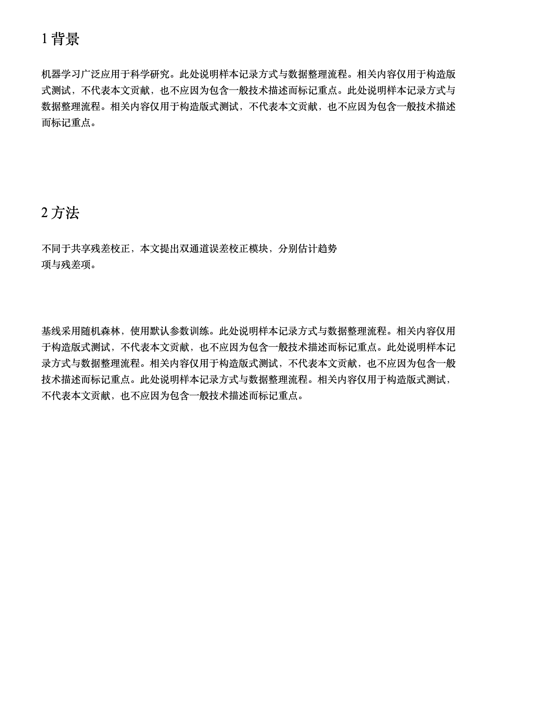
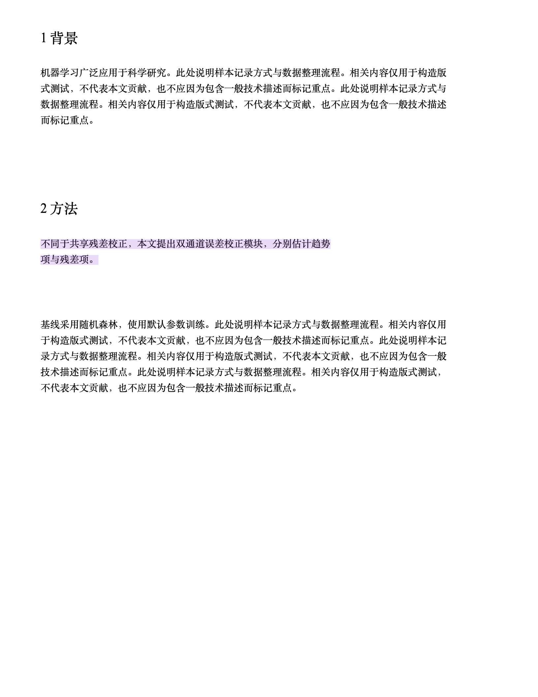
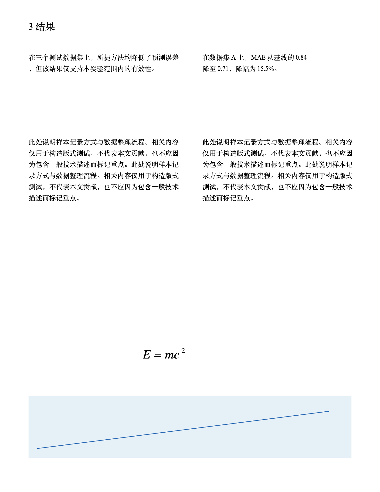
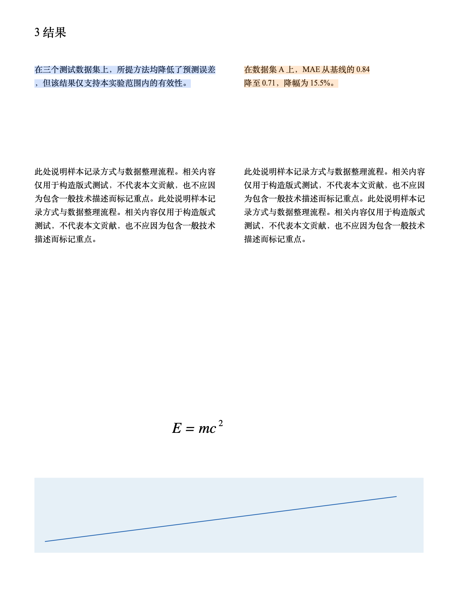

# AI 科研重点标注：原生页面前后对照

以下均来自本机 Zotero 10.0.6 的实际 PDF.js 页面画布，使用同一三页原创中文测试文件。截图含合成研究陈述和虚构数值，六项参考标签已由用户确认。模型候选来自脚本化本机 Mock；图像说明工程定位、颜色和版式，不证明真实模型的科研识别准确率。

第 1 页：紫色方法创新。普通背景与随机森林基线说明不标记。

| 原页面 | 标注后 |
| --- | --- |
|  |  |

第 2 页：左栏蓝色核心发现保留“仅支持本实验范围”的限定，右栏橙色数据保留数据集、指标、基线数值、结果及比较；公式和图形保持原位。

| 原页面 | 标注后 |
| --- | --- |
|  |  |

第三页没有充分证据，因此没有标记。源参照见 [六项用户确认样例](../../tests/fixtures/highlight-gold.json)，本轮固定候选过滤计分见 [评估记录](reference-evaluation.json)，完整验证和未验证事项见 [测试记录](../../V020_TEST_RESULTS.md)。
